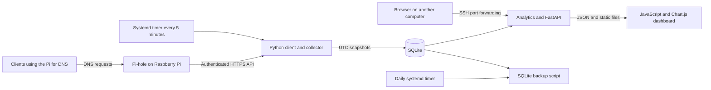

# Raspberry Pi HomeLab: DNS Monitoring Dashboard

I built this DNS monitoring application on a Raspberry Pi 5 to get more experience with Linux, backend development, and running software on an actual server instead of just my laptop.

[Pi-hole](https://pi-hole.net/) handles DNS filtering. The application in this repository is the part I built around it: a Python collector that requests statistics through its authenticated API, a SQLite database that saves snapshots, a FastAPI backend, and a dashboard for viewing the results. I also configured Linux services to collect data automatically, keep the dashboard running, and back up the database.


## What it does

- **Collects DNS statistics automatically.** A systemd timer runs the Python collector about every five minutes. Each run authenticates with the DNS service over HTTPS, retrieves DNS query totals, and records a snapshot with a UTC timestamp.
- **Stores historical data.** SQLite saves the snapshots and uses database constraints to reject invalid query counts. SQL queries calculate blocking percentages and retrieve data for specific time periods.
- **Displays the data in a dashboard.** FastAPI provides the API and serves a dashboard written with HTML, CSS, JavaScript, and Chart.js. It shows the latest query totals, a graph of blocking percentages over the past 24 hours, and whether the data is recent. The page refreshes its data every minute.
- **Runs without an open SSH session.** systemd manages the dashboard server, restarts it if the process fails, and schedules collection and backup jobs.
- **Creates database backups.** A Python script uses SQLite's backup API to copy the database and check its integrity. I also tested restoring a backup into a separate database.

## Architecture



The database stores DNS summary statistics, not individual DNS requests or packet captures. I wanted enough data to show trends over time without collecting more information than the application needed.

### Technologies

| Area | Tools |
| --- | --- |
| Hardware and OS | Raspberry Pi 5 (8 GB), Debian 13 (Trixie) |
| DNS filtering | Pi-hole and its HTTPS API |
| Backend | Python, FastAPI, Uvicorn |
| Database | SQLite and SQL |
| Frontend | HTML, CSS, JavaScript, Chart.js |
| Deployment | systemd user services and timers, SSH |
| Testing | Python `unittest`, mocked API requests, FastAPI `TestClient` |

I chose plain JavaScript over a frontend framework because the interface only needs a few metrics and a graph. SQLite also made sense for a project running on one machine and storing a few snapshots per hour.

## Repository layout

```text
.
├── pihole_client.py       # Authenticates and requests DNS data
├── collector.py           # Collects and saves DNS statistics
├── database.py            # Database setup and inserts
├── schema.sql             # Snapshot table and constraints
├── analytics.py           # Calculates rates and queries history
├── api.py                 # API routes and dashboard hosting
├── backup.py              # Database backup and integrity check
├── requirements.txt       # Python dependencies
├── frontend/              # HTML, CSS, and JavaScript dashboard
├── deploy/systemd/        # Linux service and timer files
├── tests/                 # Unit and API tests
└── test_api.py            # Early manual DNS API test script
```

The live database, credentials, logs, backups, and local certificate files are excluded from Git.

## Running it on a Raspberry Pi

This is a project I deployed on my own Pi, not a hosted demo or an automatic installer. You'll need Pi-hole and SSH working before setting up the application.

**Requirements:** a Linux machine with Pi-hole's `/api/auth` and `/api/stats/summary` endpoints available, Python 3 (I used Python 3.13), and an administrator password for the DNS service. The Python client currently connects to `https://pi.hole/api`.

### 1. Clone the project and install dependencies

```bash
git clone https://github.com/matvuc/homelab-network-monitoring.git
cd homelab-network-monitoring
python3 -m venv .venv
source .venv/bin/activate
python -m pip install -r requirements.txt
```

`requirements.txt` contains the versions tested in my virtual environment. `httpx` supports the FastAPI test client, and `requests` is used by the separate `test_api.py` script. The actual collector uses Python's built in `urllib` module.

### 2. Configure Pi-hole access

Create a `.env` file in the project folder:

```dotenv
PIHOLE_PASSWORD=your-pihole-password
```

The Python client expects a trusted certificate authority file at `certs/pihole-ca.crt` to verify the HTTPS connection. You need to supply the certificate for your own installation. Keep both the password and local certificate files out of Git, and don't disable certificate verification as a workaround.

The hostname `pi.hole` also needs to resolve on the computer running the collector. Since both the collector and DNS service run on the same Raspberry Pi, I mapped `pi.hole` to `127.0.0.1` in the Pi's persistent local host configuration.

You can check name resolution with:

```bash
getent hosts pi.hole
```

If cloud-init manages `/etc/hosts` on your system, change the configuration that generates the file so the mapping survives a reboot. This setting is part of my Pi's local configuration, not the GitHub repository.

### 3. Collect data and start the dashboard

```bash
python -c 'from database import initialize_database; initialize_database()'
python collector.py
uvicorn api:app --host 127.0.0.1 --port 8000
```

Check `http://127.0.0.1:8000/health` on the Pi. It should respond with `{"status":"ok"}`. The dashboard is available at `http://127.0.0.1:8000/dashboard`.

### 4. Set up the Linux services

The service and timer files are in `deploy/systemd/`. **Before installing them, replace `/home/matvuck/pihole-analytics` in the service files with the path to your own project directory.** The files also reference the Python virtual environment at that path.

```bash
mkdir -p ~/.config/systemd/user
cp deploy/systemd/* ~/.config/systemd/user/
systemctl --user daemon-reload
systemctl --user enable --now pihole-dashboard.service
systemctl --user enable --now pihole-collector.timer
systemctl --user enable --now pihole-backup.timer
systemctl --user list-timers --all
```

I enabled lingering for the Linux user account so these services could run after a reboot even when nobody was logged in:

```bash
sudo loginctl enable-linger "$USER"
```

The collector runs about every five minutes, and the backup timer is configured for 3:00 AM according to the Pi's local time. The dashboard listens only on `127.0.0.1`, so it is not directly exposed to the home network.

### Viewing the dashboard from another computer

Run this on your laptop or desktop, **not** on the Pi:

```bash
ssh -N -L 8000:127.0.0.1:8000 <pi-user>@<pi-lan-ip>
```

Then open `http://127.0.0.1:8000/dashboard` in your browser. The SSH tunnel needs to stay running while you're using the dashboard.

## API endpoints

| Route | Description |
| --- | --- |
| `GET /health` | Returns `{"status":"ok"}` when the API is responding |
| `GET /api/dns/blocking-rates?limit=10` | Gets recent snapshots, newest first. Accepts a limit from 1 to 100 |
| `GET /api/dns/history?start_utc=...&end_utc=...` | Gets snapshots in chronological order for a specified time range |
| `GET /dashboard` | Serves the dashboard; CSS and JavaScript are under `/static/` |

Example snapshot response (sample values):

```json
{
  "collected_at_utc": "2026-11-22T20:50:07+00:00",
  "total_queries": 1000,
  "blocked_queries": 200,
  "block_percentage": 20.0
}
```

The history endpoint requires timestamps with timezone information. It rejects invalid timestamps, reversed date ranges, and requests longer than 30 days with HTTP 422. Responses are limited to 1,000 records; pagination is not implemented yet. The dashboard requests the past 24 hours, which normally fits within that limit.

Blocking percentages are calculated from the totals saved with each snapshot. When there are zero queries, the calculated percentage is `null` rather than dividing by zero.

## Testing and reliability

Run the automated tests with:

```bash
python -m unittest discover -s tests -v
```

Tests cover DNS API authentication and errors, collector failures, database constraints, SQL calculations, timestamp handling, API validation, and the 1,000 record history limit.

I also tested these things that the unit tests don't cover but I found important:

- Stopped the Uvicorn process and confirmed systemd restarted it and the API responded again.
- Rebooted the Raspberry Pi and confirmed the dashboard and collector timer were running without another login.
- Ran the backup service, checked a saved database with `PRAGMA integrity_check`, and successfully restored a copy into a separate database.
- Confirmed the collector ran on its own timer after the final reboot, not just when I started it manually.

The backup script saves timestamped database copies in `backups/`. It doesn't currently delete older backups or copy them to another device automatically. I transferred copies to my MacBook manually with SCP.

## Some Problems I worked through

### Unreliable SSH connections

At first, SSH worked inconsistently when I kept the Pi upstairs. I checked IP addresses, hostname resolution, and basic network connectivity, then compared what happened when the Pi was in different parts of the house. The real issue was a weak wireless signal upstairs, not a problem with the SSH service. Moving the Pi closer to the router made the connection reliable, and I configured a static local IP address so it would be easier to manage.

### The dashboard worked, but the collector stopped

After a reboot, the dashboard still loaded, but the last update showed **DELAYED**. The collector timer was enabled, but recent runs had failed. I checked the systemd logs and found a Python `URLError`. The DNS service was running, but the Raspberry Pi couldn't resolve `pi.hole` using its configured DNS server.

I made the local hostname mapping persistent, kept HTTPS certificate verification enabled, and rebooted again. The next scheduled run collected a new snapshot, and the dashboard showed **FRESH**.

This was a useful lesson in troubleshooting: just because a web server is responding doesn't mean the data behind it is still being updated. The `/health` endpoint checks whether FastAPI is responding, not whether the collector is working.

## Current limitations

- **The DNS statistics are snapshots, not separate five minute totals.** Pi-hole reports statistics over a rolling time window, so consecutive samples overlap. Adding them together would give a misleading traffic count. The graph shows the blocking percentage recorded at each sample.
- **It only sees clients configured to use this DNS server.** The application doesn't capture network packets or track every device connected to the router.
- **Freshness is calculated in the browser.** A sample is marked **FRESH** when it is less than 10 minutes old, **DELAYED** from 10 through 15 minutes, and **STALE** after 15 minutes. If the browser clock makes a timestamp appear to be in the future, it shows **CLOCK ERROR**. There are no automatic failure alerts.
- **Access and historical queries are limited by design.** The dashboard is available through a local SSH tunnel, Chart.js loads from a CDN, and the history endpoint doesn't support pagination yet.

If I continue working on it, I'd like to add pagination, automatic copies of backups to another machine, and checks that report collector failures without needing to open the dashboard. I would possibly also try to add more analytics/charts and make the dashboard more interactive.
